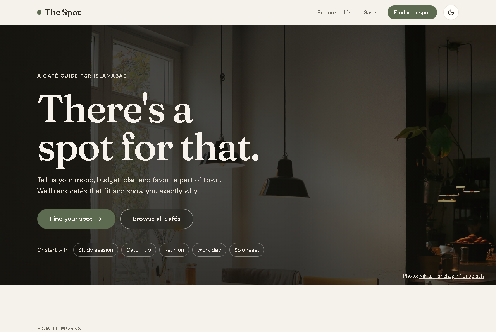
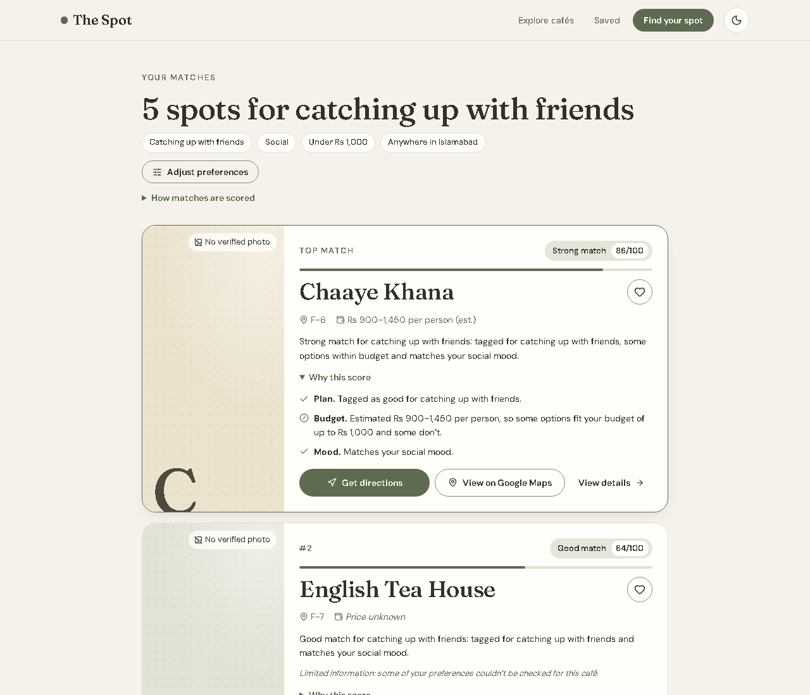
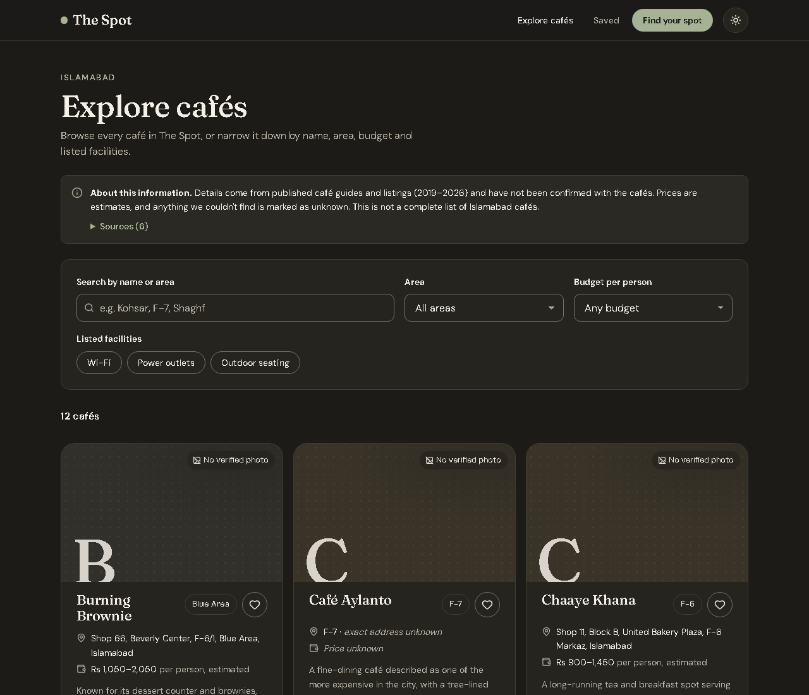
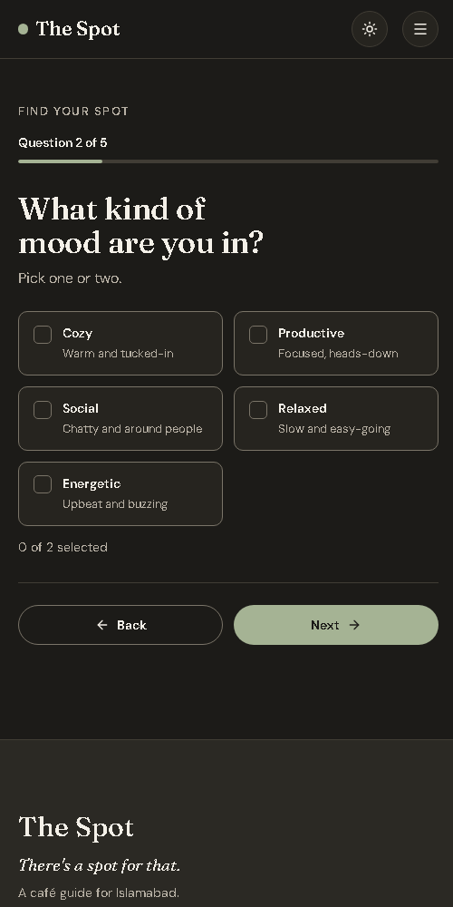
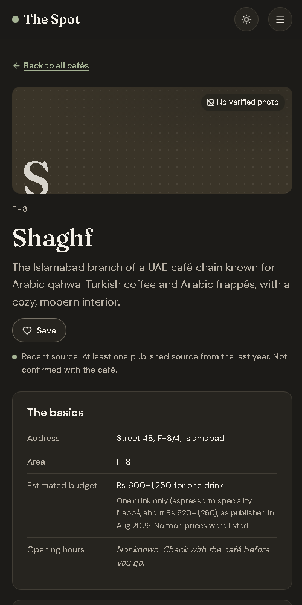

# The Spot

**There's a spot for that.**

The Spot is a café discovery web app for Islamabad. Instead of scrolling through generic listings, you
say what you need right now (your plan, your mood, a budget in PKR, the areas that suit you) and The
Spot ranks cafés with a transparent scoring formula and explains every match.



> **Status:** a working portfolio project. It is not deployed yet. The café data is small (12
> branches) and compiled from published guides; see [Data integrity](#data-integrity).

---

## The problem it solves

"Where should I go?" depends on the plan. Somewhere for exam prep is the wrong pick for a reunion
with old friends, and a lively brunch spot isn't a solo reset. Most café lists are sorted by popularity or star ratings, which
don't answer the question you're actually asking. The Spot starts with your plan and explains its
reasoning, including what it doesn't know.

## Features

- **Personalised questionnaire:** five short questions. Plan (studying, working, catching up with
  friends, reunions and group gatherings, casual meetups or a solo outing), mood (one or two) and
  budget are required; areas, atmosphere and facilities are optional.
- **Transparent recommendations:** a deterministic JavaScript scoring model (no AI, no external API).
  Each result shows a score, a label and a line-by-line "Why this score".
- **Honest about unknowns:** missing information never counts as a match. Unknown prices,
  facilities and addresses are labelled as unknown.
- **"Want more options?":** when results are thin, the app tests which preference to relax against
  the real data, and only suggests changes that actually find more cafés.
- **Explore page:** search (ignores case, accents and hyphens), plus area, budget and facility
  filters. Filters live in the URL, so they survive a refresh and can be shared.
- **Café details:** every known fact, clearly marked unknowns, and the sources behind each detail.
- **Google Maps on every card:** "Get directions" opens Google Maps with the café as the destination,
  starting from your current location when your device shares it. "View on Google Maps" finds the
  café by name and address. Both use plain [Google Maps URLs](https://developers.google.com/maps/documentation/urls/get-started),
  so no API key or billing is needed. Cafés without a recorded address get an area search instead of
  directions, so you're never sent to a guessed location.
- **Saved cafés and recent searches:** stored in your browser only, with no account. Handles
  corrupted or blocked storage, and stays in sync across tabs.
- **Editorial design:** a photographic homepage, gentle scroll-in animations and hover effects.
  All motion is switched off for people who prefer reduced motion, and content is never hidden if
  an animation or JavaScript fails.
- **Light and dark themes:** follows your system on first visit, remembers your choice, and avoids
  a flash of the wrong theme.
- **Accessible:** keyboard support throughout, visible focus, real form controls, a skip link,
  screen-reader labels, reduced-motion support, and WCAG AA contrast checked by automated tests.

| Ranked results with explanations | Explore, dark theme |
|---|---|
|  |  |

| Questionnaire on a phone | Café details on a phone |
|---|---|
|  |  |

## Tech stack

| | |
|---|---|
| UI | [React 19](https://react.dev) |
| Build tool | [Vite 8](https://vite.dev) |
| Routing | [React Router 8](https://reactrouter.com) |
| Styling | Plain CSS with design tokens (custom properties), no CSS framework |
| Icons | [Lucide](https://lucide.dev) |
| Fonts | Fraunces and DM Sans, self-hosted via [Fontsource](https://fontsource.org) |
| Tests | [Vitest](https://vitest.dev) |
| Linting | [ESLint](https://eslint.org) with React hooks rules |
| Data | A local JSON file. No backend, database, accounts or paid APIs |

## Getting started

**Requirements:** [Node.js](https://nodejs.org) 22.12 or newer (Node 24 recommended) and npm.

```bash
git clone <your-repository-url>
cd <your-repository-folder>
npm install
npm run dev
```

Then open http://localhost:5173.

### Commands

| Command | What it does |
|---|---|
| `npm run dev` | Start the development server with hot reload |
| `npm test` | Run the unit tests once |
| `npm run test:watch` | Re-run the tests as you edit |
| `npm run lint` | Check the code with ESLint |
| `npm run build` | Create a production build in `dist/` |
| `npm run preview` | Serve the production build locally to check it |

Run `npm test`, `npm run lint` and `npm run build` before committing. See
[docs/TESTING.md](docs/TESTING.md) for the full regression checklist.

## How recommendations work

Every café is scored against your answers on six criteria:

| Criterion | Weight |
|---|---:|
| Purpose (your plan) | 25 |
| Budget | 25 |
| Mood | 20 |
| Atmosphere | 15 |
| Location | 10 |
| Facilities | 5 |

Each criterion is a **match** (full credit), **partial** (some credit, e.g. a café tagged for
working is a partial match for studying), **mismatch** (0), **unknown** (0, but still counted), or
**not asked** (left out entirely).

```
score = 100 × (points earned) ÷ (points possible for the questions you answered)
```

This makes two rules hold. **Missing data lowers a score, never raises it**, and **skipping a
question never penalises a café**. Ties are broken by how much we know about the café, then
alphabetically, so identical answers always give identical rankings. Cafés scoring under 25 aren't
recommended.

The full model, with a worked example, is in [docs/ALGORITHM.md](docs/ALGORITHM.md). The code is
[`src/lib/recommend.js`](src/lib/recommend.js).

## Data integrity

Café information lives in [`src/data/cafes.json`](src/data/cafes.json). The rules:

- **Nothing is invented.** Addresses, prices and facilities come only from cited, dated sources.
  Anything not found is `null` (unknown), and the app says so.
- **Every source is recorded.** Each café lists its sources and which source backs which field.
  The details page shows this too.
- **Budgets are estimates:** one drink plus one food item, calculated from published 2026 menu
  prices, with the calculation written down.
- **Tags are editorial.** Mood, purpose and atmosphere tags are interpretations of published
  descriptions, and are labelled as such.
- **No fake ratings, reviews or popularity numbers**, and no photos presented as real when they
  couldn't be verified. Every café uses a labelled placeholder.
- **Tests enforce the rules.** For example, a facility marked as available without a cited source
  fails the test suite.

The current data covers **12 café branches**, compiled in October 2026 from guides published
2019–2026. **None of it has been confirmed directly with the cafés.** The schema, editing rules and
sources are in [docs/DATA.md](docs/DATA.md).

### Dataset fields (summary)

| Field | Meaning |
|---|---|
| `id`, `name`, `branch` | Identity |
| `area`, `address` | Location (or `null`) |
| `estimatedBudgetPerPerson` | `{ min, max, basis, sourceId }` in PKR, or `null` |
| `moods`, `purposes`, `atmosphere` | Editorial tags |
| `facilities`, `outdoorSeating` | `true` / `false` / `null` (unknown) |
| `openingHours`, `website`, `instagram`, `imageUrl` | Optional; `null` when unverified |
| `googlePlaceId` | Optional verified Google place ID, used to make Maps links exact |
| `sourceIds`, `fieldSources` | Which sources back which fields |
| `lastChecked`, `dataConfidence` | When it was reviewed, and how recent the sources are |

## Project structure

```
src/
  assets/photos/ Homepage photography (resized WebP, credited in data/photos.js)
  data/          cafes.json and the loader, plus photos.js (photo credits)
  lib/           Pure logic, no React: recommendation engine, preferences,
                 search and filters, storage helpers (all unit tested)
  context/       Saved cafés and recent searches, shared across the app
  components/    Reusable UI: cards, buttons, questionnaire parts, results parts
  pages/         One component per route
  styles/        Design tokens, base styles, shared components, contrast test
docs/            Algorithm, data and testing documentation, screenshots
```

Routes: `/` home · `/explore` · `/find` questionnaire · `/results?…` · `/cafe/:id` · `/saved`

## Limitations

- **Small, partly dated dataset.** Twelve branches, with many addresses from 2019–2021 sources.
  Things may have changed.
- **No café is tagged for studying or quiet yet**, so study searches rely on related tags (working,
  calm) and top out around "Good match". The explanations say so.
- **No verified photos or opening hours for the cafés.** Café cards use labelled placeholders. The
  homepage photography is illustrative stock photography from outside Pakistan, and is never shown
  next to a named café.
- **Google Maps finds cafés by name and address.** No café has a verified Google place ID yet, so
  Google picks the matching pin, and it's worth checking before you set off. If a place ID is added
  to the data (`googlePlaceId`), the links use it automatically.
- **No real café photos yet.** No photos with permission to reuse were found (official websites,
  café-owned accounts). Google Places photos would need a billing-enabled Google Cloud project and
  must be loaded live with Google attribution, so they aren't used.
- **Saved cafés stay in one browser.** There are no accounts, by design.
- **The scoring weights are a starting point** and haven't been tuned with real user feedback.
- **Accessibility is partly unverified.** It's been checked with automated audits and keyboard
  testing, but not yet with a real screen reader or on physical devices.

## Future improvements

- Verify cafés directly and add opening hours, facilities and licensed photos
- Expand coverage to more areas (G-sectors, E-11, DHA, Bahria Town)
- A simple form or workflow for suggesting corrections
- Tune the weights using anonymous, opt-in feedback ("Was this a good match?")
- Show "open now" once reliable opening hours exist
- An end-to-end browser test suite (for example Playwright) in CI

## Deployment

The app is a static site: `npm run build` produces plain HTML, CSS and JavaScript in `dist/`, so it
can be hosted on any static host, with no server or environment variables needed.

**Vercel (free Hobby plan):**

1. Push the repository to GitHub.
2. In Vercel, choose **Add New → Project** and import the repository.
3. Vercel detects Vite automatically: build command `npm run build`, output directory `dist`.
   No environment variables are needed.
4. Deploy. After that, every push to `main` redeploys automatically.

Because the app uses client-side routing (e.g. `/explore`, `/cafe/shaghf-f8`), the host must send
every path to `index.html`. [`vercel.json`](vercel.json) does this with the rewrite that Vercel
recommends for Vite apps. Real files such as scripts, styles and fonts are still served directly.

The Hobby plan is free for **personal, non-commercial** projects. As of Vercel's docs (September
2026) it includes 100 GB of data transfer and 1 million requests a month. If a limit is exceeded, the
feature pauses for 30 days rather than billing you. The Spot is a static site with no server
functions, so it uses very little of this.

## Acknowledgements

Café information was compiled from public articles and listings by The Pakistan Connect,
Zameen.com, ProPakistani, Wanderlog and Arab News. Full citations (title, publisher, date and link)
are shown in the app and stored in [`src/data/cafes.json`](src/data/cafes.json). The Spot isn't
affiliated with any café listed.

### Photography

Homepage photos are from [Unsplash](https://unsplash.com) and are free to use under the
[Unsplash License](https://unsplash.com/license). They're illustrative and don't show the cafés
listed in The Spot. They're stored in [`src/assets/photos/`](src/assets/photos) as resized WebP files,
and listed with their credits in [`src/data/photos.js`](src/data/photos.js).

| Photo | Photographer |
|---|---|
| [Café interior with window light](https://unsplash.com/photos/cafe-interior-with-tables-and-chairs-near-window-B5giYHNQPvA) (hero) | Nikita Pishchugin |
| [Cozy café interior](https://unsplash.com/photos/a-cozy-cafe-interior-with-warm-lighting-and-furniture-0i5clWZBit0) | Kouji Tsuru |
| [Library-themed café](https://unsplash.com/photos/a-library-themed-cafe-with-wooden-shelves-NtCXVLvJfdQ) | Raymond Yeung |
| [Studying together at a laptop](https://unsplash.com/photos/two-women-studying-together-at-a-table-with-laptop-2FDdgn0-W_o) | Chidera Faustina Okeke |
| [Four friends at a café table](https://unsplash.com/photos/four-friends-are-sitting-together-at-a-table-wAntJVFnMh8) | Vitaly Gariev |
| [Reading a book](https://unsplash.com/photos/a-person-reading-a-book-Z4LY9zQ3sIg) | Ivan Le |

The latte-art photo ([`public/latte-art.jpg`](public/latte-art.jpg)) belongs to
The Spot.
